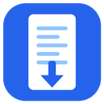
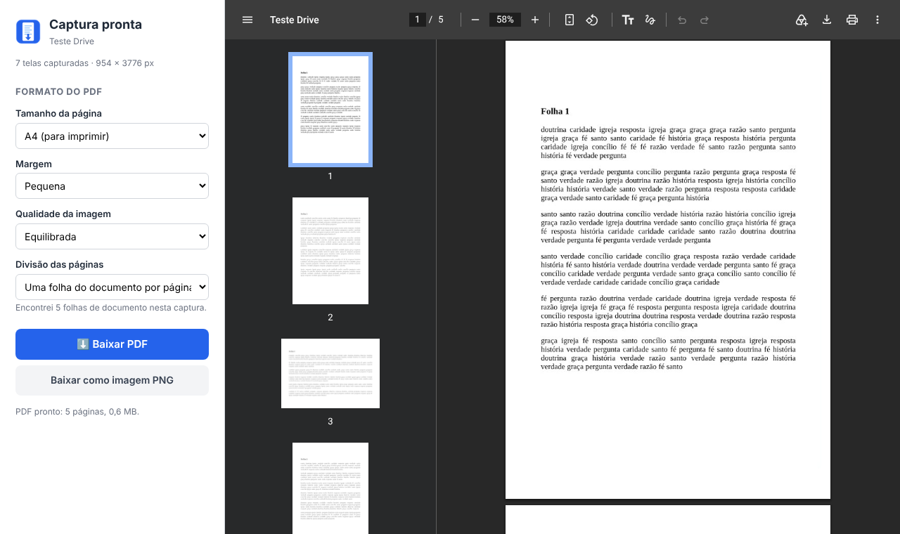

  

<h1 align="center">Captura Página Inteira</h1>

  Extensão para Google Chrome que rola a página sozinha, tira um print de cada tela e junta tudo em um <strong>PDF</strong> ou <strong>PNG</strong>. 
  Uma alternativa simples, gratuita e em português ao GoFullPage e ao FireShot.

  

## Recursos

- **Página inteira de uma vez:** a página rola sozinha, de cima até embaixo, e os prints são emendados sem costura.
- **Cabeçalhos fixos aparecem uma vez só:** menus e barras que acompanham a rolagem são escondidos depois do primeiro print.
- **Funciona em sites tipo aplicativo:** Gmail, Google Drive e outros em que só uma área interna rola.
- **Uma folha do documento por página:** ao capturar um PDF aberto no visualizador do Google Drive, cada folha vira uma página do PDF final. O cinza em volta é removido e a orientação (em pé ou deitada) é escolhida sozinha.
- **Não corta linhas de texto:** na quebra de página, a extensão procura um espaço em branco para cortar.
- **Formatos:** A4, Carta ou uma página única contínua, com margem e qualidade ajustáveis.
- **Sem internet e sem rastreamento:** tudo acontece no seu computador, sem bibliotecas externas e sem enviar nada para fora.

## Instalação

1. Nesta página, clique no botão verde **Code → Download ZIP** e descompacte o arquivo.
2. No Chrome, abra `chrome://extensions`.
3. Ative o **Modo do desenvolvedor** (canto superior direito).
4. Clique em **Carregar sem compactação** e escolha a pasta descompactada (a que contém o `manifest.json`).
5. Fixe o ícone azul na barra do Chrome.

> Em Chromebooks gerenciados por escola ou empresa, o Modo do desenvolvedor costuma estar bloqueado pelo administrador.

## Como usar

1. Abra a página que quer capturar.
2. Clique no ícone da extensão ou use o atalho **Alt+Shift+P**.
3. Clique em **📸 Capturar página inteira** e não troque de aba até terminar. O ícone mostra a porcentagem.
4. Abre uma aba com a pré-visualização. Ajuste o formato e clique em **Baixar PDF**.

**Dica:** em sites que só carregam as imagens quando você rola até elas, escolha uma espera mais lenta na janelinha do ícone.

## Limitações

- O Chrome não permite capturar páginas internas (`chrome://`) nem a Chrome Web Store.
- A captura para em 150 telas.
- Páginas com rolagem horizontal são capturadas apenas na largura visível.

## Estrutura do código

| Arquivo | Função |
|---|---|
| `manifest.json` | Configuração da extensão (Manifest V3) |
| `background.js` | Rola a página, esconde elementos fixos e tira os prints |
| `popup.html/js/css` | Janelinha do ícone |
| `result.html/js/css` | Monta a imagem, divide em páginas e gera o PDF |
| `pdf.js` | Gerador de PDF próprio, sem dependências |
| `db.js` | Guarda os prints temporariamente (IndexedDB) |

## Licença

[MIT](LICENSE): use, modifique e redistribua à vontade, mantendo o aviso de autoria.
